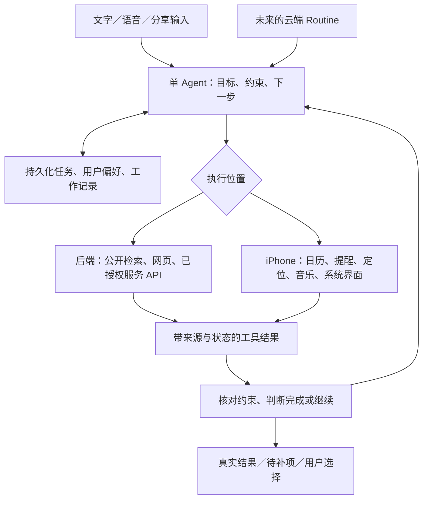

# 代号鲸鱼01：企划复盘、Grok Bot 对标与拓展路线

日期：2026-11-09｜审阅角色：产品与架构“大脑”｜技术基线：iPhone 原生、DeepSeek API、讯飞语音

本文件是依据企划、当前源码和公开官方资料形成的执行建议，不是新增功能的完成声明。源码在并行更新，新增实现必须绑定具体 commit、Build 和真机证据重新确认。旧 UI 方案继续按 13_UI方案废弃决定.md 停用。

## 1. 产品判断

原企划对“工具调用、系统授权、结果真实性、幂等、供应商分工”的方向是对的，可以继续使用。但产品重心仍然偏向一组功能入口，缺少持续完成用户目标、重复使用、主动服务和跨会话记忆的设计。

建议定位为：**一个懂用户习惯、能查当前信息、能在 iPhone 上完成日常小任务、可以自然交谈的个人助手。**

优先形成三个可以每天使用的场景：

1. **出门前**：看当天日程、查实际天气、发现时间冲突、准备出行建议。
2. **临时办事**：找附近地点、比较有来源的信息、调整提醒和日程、交接地图。
3. **轻松陪伴**：自然聊天、播放可用音乐、谈论用户分享的文章或图片、记住明确偏好。

有效留存来自“少做几步、少重复解释、结果可信、交流舒服”。日常办事的目标应该是更快办完；长时间互动应由用户自愿选择的聊天、阅读、音乐和创作提供，不能靠冗长回复或反复确认拖延。

## 2. Grok Bot 的对标对象和架构区别

本次以官方 **Grok Bot** 文档为主，不把它与 Grok 普通聊天 App、语音 API、虚拟角色体验混为一谈。

截至本次查阅，官方资料描述 Grok Bot 的关键能力是：连接应用及 MCP/API、持续云端电脑、跨任务记忆、可复用 Skill、定时／事件 Routine、语音、文件、任务审批、多个 Bot 协作。手机是入口之一，云端任务可以在手机关闭后继续。

官方移动文档同时明确：调用手机的日历、联系人、定位、提醒、Home 等能力需要相应权限；**手机 App 关闭或处于后台时，Bot 不能继续访问这些手机工具**。云端持续工作不等于手机可以一直后台操作系统。



鲸鱼01已经具备上图中 Agent 和原生工具的基础，不必从头重做。缺少的主要是信息渠道、任务完成判定、记忆、可靠恢复和完整语音。云端电脑、多 Bot 团队是后期路线，当前不作为首个可用版本的前提。

## 3. 当前状态：源码证据与验收分开

| 模块 | 本次观察到的证据 | 可以怎样表述 |
|---|---|---|
| 原生工程与打包 | SwiftUI 工程、GitHub macOS 构建流程、既有可安装包与手机反馈 | 已有原生基础；构建／安装不等于所有功能通过验收 |
| DeepSeek 与 Agent | backend/src/adapters.mjs、agent.mjs、conversation.mjs、capabilities.mjs | 已有真实模型适配、工具编排和会话框架 |
| Skill 与 Tool | contracts/v1/tools.v1.json，六组业务 Skill、十五个契约工具 | 已有能力定义；注册数量不代表真机可用数量 |
| 日历、提醒、音乐、地图 | ios/WhaleAgent/Execution 下已有执行器 | 具备实现基础；需按具体 Build 验证授权、结果和失败路径 |
| 当前位置／2km 搜索 | LocationExecutor 接受 near／region，但没有实际设备定位请求与半径过滤 | 尚未形成用户要求的附近范围搜索闭环 |
| 商户价格 | 地点结果没有菜单／人均来源，也没有实际价格检索工具 | 当前缺数据渠道，不能承诺真实预算筛选 |
| 讯飞识别 | 新增 XfyunConfig、XfyunASRClient；配置后走讯飞，否则系统听写 | 新增 ASR 源码；不等于讯飞账号已配置、已真机验收 |
| 语音播报／打断 | 本次源码检索未发现完整 TTS 与播报调度链路 | 需要补齐；不能把听写等同于语音对话 |
| 分享入口 | 新增 Share Extension、SharedInbox、主 App ingest 逻辑 | 分享源码已新增；签名、交接、正文完整性需验证，链接检索仍需接通 |
| Siri／快捷指令 | 新增 CreateReminderIntent 与 WhaleShortcuts | 已有入口源码；当前 Intent 直接写 EventKit，应复用执行器及操作日志 |
| 通讯回调 | MessageExecutor 新增短信／邮件发送、取消等 Notification 回调 | 较旧审计有进展；还要验证回调与 operationId／本轮任务关联，不只显示一段提示 |
| 天气／健康 | 当前 FREE_SIGNING 路由明确禁用 WeatherKit／HealthKit 工具 | 当前安装版本有能力限制；不能直接把完整签名目标的功能当作已安装版本功能 |
| 页面双向历史 | 当前 RootView 主体仍为四个 Tab；没有据此证明左右滑页面历史已实现 | Tab 切换不等于负责人指定的左滑返回／右滑前进 |

当前质量报告的 30/30 是**真实 DeepSeek＋Mock 工具执行下的确定性轨迹／参数检查**，报告自己也说明语义项需要人工复核。它不能证明所有回答自然、原生系统功能成功或全部企划完成。先前独立 HTML 审计是较早快照，最新新增源码应补充证据后更新状态。

## 4. 与 Grok Bot 相比的不足：为什么、怎么补

| 维度 | 差距及原因 | 具体做法 | 优先级 |
|---|---|---|---|
| 连续办事 | 一轮有回复容易被当成任务完成；用户目标、未满足条件与工具结果未充分绑定 | TaskRecord 保存目标／硬约束／已完成步骤／未完成项；每次工具结果后核对并继续 | P0 |
| 自主取得信息 | 定位只授权未取值，价格没有来源；模型无法靠文字推理生成真实信息 | 本地取位置与半径过滤；后端接公开检索／网页获取／商户合法 API | P0／P1 |
| 自然理解 | 已有历史和槽位基础，但“第二家”“还是刚才那首”“换后天”要依赖可追溯对象 | 持久化当前候选、时间约束和引用；话题切换后能恢复；少用固定前缀和无效追问 | P0 |
| 手机功能完整性 | 日程／提醒偏创建，用户很快会需要查询、改期、完成、取消 | 增加已注册范围内的查询／修改工具；先选对象、预览差异、确认后执行 | P1 |
| 记住用户 | 会话历史不等于跨会话偏好；当前长期记忆尚无完整模块 | 先做结构化可编辑偏好＋日期化工作日志，按相关性读取；不先上复杂向量平台 | P2 |
| 主动服务 | 请求式 API 没有持久化 Routine、云端调度及通知 | 一次任务成功后存参数化流程；后端调度、运行记录、暂停和通知；手机工具离线时明确等待 | P2 |
| 应用连接 | 原生工具数量有限；尚无成熟账号连接与连接生命周期 | 对一个高频服务先接官方 API/OAuth，做到范围授权、撤销、过期重连；MCP 仅作后端适配选项 | P2 |
| 语音 | 目前更接近听写输入；没有完整识别→理解→朗读→打断 | 讯飞 ASR 最终文本走同一 Agent；增加流式 TTS、播报队列、打断和音频会话管理 | P1 |
| 文件／图片 | 分享入口新建但多模态链路、文件读取与内容来源还不完整 | 文本提取、Vision OCR、图片输入、PDF 文字提取；缺正文不假装读取；结果附内容范围 | P2 |
| 异步可靠性 | 手机／服务重启后任务容易丢；日志只存结果不足以覆盖写入中崩溃 | 执行前持久化、执行未知核对、结果待回传队列、断线查询、任务归属鉴权 | P0 |
| 可复用技能 | 当前 Skill 是六个业务组，尚不是用户可保存的跨工具流程 | 将成功的“出门简报”等保存为版本化流程，含输入、工具、完成条件和失败处理 | P2 |
| 多 Bot／云端电脑 | 当前没有持久化云端执行环境；这涉及成本、隔离、登录、审计和人工接管 | 有明确网页任务需求后单独立项；优先 API，浏览器作为有限补充；多 Agent 以实际并行收益决定 | P3 |

角色陪伴、语气风格、形象动作可以参考 Grok 的相关体验，但它们是另一个产品维度。Grok Bot 官方对标重点仍是“把事情做完”。不能只换角色和皮肤，就认为任务能力已经接近。

## 5. 为什么“写了 Agent 和 Skill”还显得傻

Agent 是决策和编排；Skill 是完成某类任务的方法；Tool／数据来源才提供真实观察和动作。当前问题来自它们之间的缺口，而不只是“模型不会思考”。

以“找附近 2 公里烧烤，看看价格”为例：

```text
用户目标：找到可比较的附近烧烤店
硬约束：当前位置、2km 范围
待取得事实：店名／分店地址／距离／有来源的价格

手机：取一次有效定位 → 搜索 → 算直线距离 → 过滤 → 排序 → limit
后端：用店名和分店地址查公开菜单／价格 → 检查来源和时间
Agent：比较有证据的候选；将没查到的价格列为未知
完成检查：是否满足地点和范围？哪些价格已取得？哪些仍缺失？
```

不能取得的价格如实说明，取得了一部分就展示那部分。导航可以作为用户选定后的下一步，不能替代查价格。取得不到价格时，给一个预算也不能凭空筛出“真实人均符合预算”的店。

建议采用以下任务结构，字段由可信编排层维护，而不是依赖模型随口说“已完成”：

```json
{
  "goal": "比较附近烧烤店",
  "constraints": {"locationMode": "current", "radiusMeters": 2000},
  "resolvedReferences": [],
  "observations": [],
  "remaining": ["取得候选", "查询有效价格来源"],
  "state": "running"
}
```

执行策略：

1. 工具能取得的信息先取；用户偏好、歧义对象或必要授权才需要询问。
2. 保留硬约束；数据不支持时返回部分完成或无法满足，不能悄悄降低条件。
3. 读操作的有限重试／替代来源可自动处理；未知写操作先核对，不自动再写。
4. 允许低风险独立查询并行，依赖步骤仍串行；多步任务按成本、时限、步数共同限制。
5. 可展示“正在找店／查询菜单”等事实进度，不展示冗长内部推理，也不靠延长回复模拟思考。
6. 简单聊天、单步工具使用低延迟路线；复杂比较再评估供应商支持的思考模式。是否启用须以任务成功率、耗时和成本实测决定。

## 6. 在既有 DeepSeek 供应商内优先评估的扩展

本次官方资料已提供 Tool Calls、思考模式工具使用、Search & Fetch、Vision。工程现有适配仍主要是 /chat/completions 的文字＋工具调用；最近质量报告使用 deepseek-chat。**文档支持某能力，不等于当前模型名、账号、适配器和手机已经支持。**

| 候选 | 官方能力与接法 | 工程需要做什么 |
|---|---|---|
| 当前信息检索 | Search API：POST /v1/tools/search | 新建后端检索执行器，注册工具，保留 URL／标题／取得时间和引用；核实账号可用性、费用和中文本地信息覆盖 |
| 链接正文获取 | Fetch API：POST /v1/tools/fetch | 新建网页获取工具；限制内容大小／超时／地址，标明取得的正文范围；只有摘要就不宣称阅读全文 |
| 图片理解 | 官方 Vision 文档当前列出 deepseek-flash 接受图像＋文字 | 比较当前账号模型；消息改成多模态内容块，手机选图／压缩／确认上传，后端限制格式与大小 |
| 复杂规划 | 官方说明思考模式可以结合工具调用 | 先在复杂留出任务测试；适配必要的历史／响应字段和流式行为；不直接切换全部普通聊天 |

图片中的文字识别可先在手机用 Apple Vision 完成，图表、实物、照片语义理解再走实际支持图像的模型。搜索结果也不天然是商户真实价格，需要匹配分店、区分套餐／单品／人均、记录更新时间。供应商最新型号不自动等于最佳配置，先做小样本对比，继续使用既有供应商。

## 7. 可实施的新增功能清单

### 7.1 优先新增：让现在的助手更有用

| 功能 | 用户能怎样说 | 实现路径 | 核心验收 |
|---|---|---|---|
| 真正的附近范围搜索 | “找我两公里内营业的咖啡店” | CoreLocation＋MapKit＋radiusMeters；营业信息由另有来源的详情补充 | 有有效定位才说当前位置；所有展示距离注明类型；营业状态未知就标未知 |
| 有来源的问答／查价 | “这两家价格多少，哪个合适？” | 后端公开搜索＋网页获取＋来源归一化 | 每条外部事实可点开来源；未知不填零，套餐不当人均 |
| 日程／提醒的修改闭环 | “把刚才的健身改到周五”“这条已经做完” | EventKit 查询对象＋版本化 update／complete 工具 | 只改变选中记录，处理多匹配和过期；展示前后差异，不用另建一条假装修改 |
| 真实音乐控制 | “继续刚才那首”“换点轻松的” | 复用 MusicExecutor，查询播放状态；许可曲库内推荐 | 可用曲目才播放，实际播放器状态与回复一致，区分本地／云曲目限制 |
| 连续语音与打断 | “先停一下，我换个问题” | 讯飞 ASR／TTS＋AVAudioSession＋取消／播报调度 | 旧音频停播且不插入新轮；语音和文字共享任务上下文；打断不能默认撤销已完成写入 |

### 7.2 次优先：减少输入，建立持续使用价值

| 功能 | 示例 | 路径与约束 |
|---|---|---|
| 可编辑偏好记忆 | “记住我不吃辣、回复简短一点” | 本地结构化存储，逐次选择相关条目发给 Agent；用户能查看／改／删；偏好不能升级成永久操作授权 |
| 截图／照片待办提取 | “把这张通知里的时间记下来” | PhotosPicker／分享图片＋Vision OCR／实际视觉模型；识别的关键时间先核对，再走 EventKit |
| PDF／文章阅读助手 | “总结这份 PDF，列出我要做的事” | 用户选文件，PDFKit 文字提取，扫描件 OCR；长文分段并保留页码／范围；提取任务不自动全部写入 |
| 语音笔记／当天回顾 | “记一下刚才的想法”“今天做了什么” | 用户主动录音，讯飞转写，笔记和工作日志持久化；不擅自录制电话或后台环境声音 |
| 快捷入口 | “用 Siri 打开鲸鱼开始听写” | App Intents、快捷指令、操作按钮、适合的小组件；复用主 App 策略与执行器 |
| 出门／晚间简报 | “帮我看看明天怎么安排” | 日程＋天气＋提醒的组合 Skill；当次在前台完成，先证明价值，再考虑自动运行 |
| 周期服务 | “每天早上告诉我是否需要带伞” | 后端 Routine＋真实天气来源＋通知；固定城市／已授权位置策略；手机来源离线时标数据时间或等待打开 |
| Home 控制 | “把书房灯调暗” | HomeKit／相关官方能力、家庭授权、实际配件与签名验证；第一阶段仅灯／场景，敏感配件另设规则 |
| 一个高频外部服务 | “汇总我授权邮箱的待办” | 官方 API／OAuth 连接；只接一个用户真用的服务验证，不先做连接器市场 |

### 7.3 后期体验：用户愿意主动停留

1. 固定且可调整的语气、称呼、幽默程度和播报速度；保持任务事实不变。
2. 主动选择的“随便聊聊／共同读文章／音乐闲聊／接龙故事／英语口语”等轻内容，能随时退出并恢复任务。
3. 2D 原创形象或简单动态角色，真实 listening／thinking／executing／waiting／speaking 状态驱动；嘴部动画先由播放音量驱动，精确口型再单独评估。
4. 轻量收藏、会话续聊与用户自己的主题库；让下次使用有明确入口。
5. 图像／视频创作作为单独服务能力评估。丹青约香蕉继续用于设计期参考与原创素材，不能假定已有运行时生图授权，也不能把一张图片当作已完成动画系统。

这些建议尚未构成新的视觉稿，旧方案继续废弃。新的 UI 工作应在任务与语音流程稳定后，根据真实交互设计展开。

## 8. Agent、Skill、Tool、Routine 怎么分工

**现在保留一个主 Agent。** 不因 Grok Bot 展示多个 Bot 就立即增加多个模型进程。

| 对象 | 做什么 | 鲸鱼01下一步 |
|---|---|---|
| Agent | 理解目标、选择能力、根据结果继续 | 完成 TaskRecord、约束验证、引用恢复、任务完成判定 |
| 基础 Skill | 告诉 Agent 怎么使用某组能力 | 继续维护六组；每组加入前置条件、失败处理、结果验证和否定示例 |
| 场景 Skill | 把多个工具组合成可复用方法 | 先做“附近比较”“出门简报”“安排空闲时段”三个，成功后再保存成模板 |
| Tool | 真实查数据或执行原子动作 | 定位范围、检索／正文、对象查询／修改、语音与内容工具按合同注册 |
| Routine | 何时重复某个流程 | 持久化 schedule／timezone／input／output／policy／budget；一次性 Skill 验证后再启用 |
| Connector | 连接外部服务账号 | 后端 OAuth、最小必要 scope、撤销与刷新，Token 不交给模型 |
| Memory | 稳定偏好与工作记录 | 独立可查可删；实时价格和权限不以旧记忆为准 |

不必同时建 Planner Agent、Executor Agent、Memory Agent、Voice Agent。它们当前更适合是一个 Agent 周围的确定性模块。复杂独立任务确实需要并行、单 Agent 实测无法满足时，才引入专职检索／整理／复核子 Agent，并给出共享信息、成本、超时和冲突规则。

MCP 是工具接入协议；它不会赋予 iPhone 任意控制其他 App 的能力，也不会创造不存在的第三方接口。当前直接 API 足够时，先保持简单。

## 9. 先修复的工程基础

### 9.1 任务真实性与恢复

- 手机操作日志从“成功后缓存结果”升级为执行前记录、执行中、成功／失败／未知的持久化状态；保存本地系统记录的核对证据。
- 手机结果使用持久化待回传队列，网络恢复后重传结果，不重做系统写入。
- turnId／conversationId／候选引用与活动任务可恢复；服务重启后不得只剩一句历史回复。
- 选择、确认、发送结果绑定任务和 operationId，旧确认失效后不能执行新参数。
- App Intent 复用提醒执行器和操作日志；避免聊天入口与 Siri 入口采用两套不一致的写入策略。

### 9.2 后端身份与供应商密钥

当前 server.mjs 路由没有可见的用户／安装身份认证及资源归属校验。随机 ID 和 CORS 都不能替代鉴权。扩展到可联网服务、持久化个人信息和通知前，补上设备／用户身份、Token 生命周期、每条任务的 owner 校验、请求限流与日志脱敏。

当前 XfyunConfig 设计从 Bundle Info 或进程环境读取 APISecret，由 ASR 客户端生成鉴权 URL。**本次没有查看任何实际秘密值，也没有证据证明已把真实密钥打入 IPA。** 但这条配置路线要求客户端持有长期秘密，应调整：按照所选讯飞产品的官方条件，由后端签名／短期凭证或代理音频。确认签名有效期、可重用性和后端身份验证；不能假设任意签名 URL 都是一用即废的安全 Token。

### 9.3 验收与性能

- 验收绑定 commit、版本／Build、iOS、设备、真实服务／Mock、授权状态及录屏／系统记录。
- 对话评分分为：目标完成、关键约束、事实来源、动作正确、追问必要性、自然程度；不能只统计工具名。
- 留出样本至少包含 100 个未写入提示词的自然表达／多轮组合。核心目标完成率 ≥90% 是建议目标；误执行、伪造成功、跨用户读写和重复写入属于阻断项，不能用平均分抵消。
- 耗时分段测量 ASR 最终文本、模型首段、工具完成、TTS 首音、打断停播。建议目标：界面反馈 <300ms；受控真机网络下打断停播 p95 <500ms。语音首响先测 30 个样本基线，再定普通对话目标，不能现在承诺复杂联网任务都秒回。

## 10. 给执行者的分阶段工作包

顺序为：**可用基础 → 可取得当前信息 → 自然语音 → 记忆与复用 → 主动服务与高级体验。** 表中估算为熟悉现有工程的单个开发者净工作日参考，合并任务避免重复计工；外部来源、账号、签名与真机条件会改变排期。

| 阶段 | 工作包 | 关联既有任务 | 参考工作量 | 出口条件 |
|---|---|---|---|---|
| R0：冻结事实 | 当前安装 Build／源码／能力表；收集真机阻断；将旧状态与新新增实现区分 | W01-001／002／025，独立审计 | 1–2 日 | 每项能力能回答是否实现、是否授权、是否实测、受什么限制 |
| R1：闭环可靠 | PLACE-01／02、PLAN-01；任务状态、鉴权、写入恢复和 Intent 复用 | 16 整改；W01-008／009／015／017／018／023 | 6–10 日 | 附近范围准确；目标不偷换；断网重启不重复写；跨身份请求被拒绝 |
| R2：当前信息 | 检索＋网页获取；商户来源匹配；链接摘要；三组组合场景 | PRICE-01，W01-019，NL-02／03／04／07 | 4–7 日 | 查到信息可溯源；查不到如实；多轮候选和约束保持 |
| R3：真实语音 | 讯飞鉴权整改、ASR 最终提交、TTS、打断、音频路由、音乐冲突处理 | XF 专项、W01-021／022，NL-08 | 5–8 日 | 连续真实说话、朗读、打断、切话题，错误可转文字 |
| R4：个人化与系统入口 | 偏好记忆、提醒／日程修改、图片／文件入口、快捷入口完善 | 扩展契约；W01-019／020／023 | 5–9 日 | 跨会话偏好可查可改可删；关键对象正确；内容可追溯 |
| R5：主动与留存 | 一次成功流程保存为 Skill；Routine、通知；轻陪伴和原创形象 | P2 单独工作包 | 5–10 日＋外部条件 | 例行任务可测试、暂停、限额；手机离线不假装执行；用户主动选择陪伴模式 |

整体不是原企划 4–6 周的同一范围。可靠语音、记忆、检索和 Routine 全部交付，按当前状态应按约 6–10 周或更长重新滚动估算；不含复杂 3D、云端电脑、多 Agent 团队、连接器市场及商用发布准备。每天用出口证据调整排期。

首批具体派工：

| ID | 交付 | 验收方法 |
|---|---|---|
| REV-01 | 新增源码与当前安装版差异表 | 记录 commit／Build，逐项列 ASR、Share、App Intent、通讯回调是否真正包含和实测 |
| PLACE-01／02 | 真定位、参数相关授权、radiusMeters 过滤 | 16 文件的定位拒绝／超时／1999m与2001m边界／旧协议用例 |
| REL-01 | 任务记录＋待回传结果队列＋未知写入核对 | 保存系统记录前后分别模拟中断，重启后查证，不重复创建 |
| SEC-01 | 身份与归属鉴权 | A 身份不能读取、确认、回传或删除 B 的任务，注销／失效 Token 被拒绝 |
| PLAN-01 | 完成条件与未满足约束 | 查价不转成导航，无价格不承诺筛预算，工具失败不宣称完成 |
| ENTRY-01 | App Intent 复用主执行器 | 聊天和快捷指令的授权、日志、错误行为一致，重复提交可核对 |
| INFO-01／02 | 后端搜索／网页获取 adapter＋Tool 契约 | 用真实来源测试中文问题、空结果、429、过期内容、恶意正文和 URL 限制 |
| PRICE-01 | 分店／价格类型／来源的归一化 | 同名分店、套餐与人均、没有价格、过期价格全部准确分类 |
| VOICE-01／02／03 | 讯飞安全接入、TTS、打断 | IPA 不需要长期 APISecret；真机语音整条链路可追溯；旧回复不继续播 |
| MEMORY-01 | 可编辑偏好 | 新会话有相关偏好，删除后不继续使用；价格不长期当作当前事实 |
| EVAL-01 | 新场景与留出评估 | 100 个留出场景，轨迹与语义两张评分表，Mock 与真机分列 |

新增工作包纳入现有主任务，不把同一底层修复重复算作多个功能“已完成”。本轮只下达可评审计划；实现者完成后提交证据，再更新执行看板和验收表。

## 11. 推荐的六个成品验收场景

1. **附近比较**：“找附近 2km 烧烤，查一下价格。”能真实定位、过滤、查询来源；部分价格未知清楚标注，不自动导航。
2. **自然改期**：“明天下午三点提醒取快递……改后天……算了取消。”跨轮保存参数；待执行取消不写入；已创建则走明确的对象查询与修改／删除路径。
3. **出门简报**：“我今天出门要注意什么？”使用实际日程、指定地点天气和可用提醒；无权限只缺相应部分，不能编造完整简报。
4. **听歌与插话**：“放点轻音乐……第二首……先停一下，我问个事。”正确引用曲目；音乐／TTS／录音互不抢占；新话题仍保留音乐状态。
5. **分享与办事**：分享一篇通知，提取时间和事项；有正文才能总结；经准确预览后创建目标记录。
6. **记忆与复用**：明确保存“不吃辣／简短回答”；新会话能引用；可改可删；“下次也这样”只保存经过验证的流程，不擅自设置周期任务。

每个场景同时验正常、缺权限、断网、取消、进程退出、信息缺失。报告“用户目标办成了多少”，而不只报告调用了几个 Tool。

## 12. 能力边界及后期取舍

| 设想 | 能否做 | 合理路线 |
|---|---|---|
| 调用其他 App 的功能 | 部分可以 | Apple 原生 API、对方公开 API／SDK、已提供的快捷指令、URL Scheme／Universal Link／分享；跳转不等于动作完成 |
| 任意读取微信聊天并替用户发送 | 普通第三方 iOS App 无法通用实现 | 用户分享选定内容；支持的官方服务接口；系统／对方界面中用户完成发送 |
| 原生闹钟／计时器 | 系统和签名条件满足时可评估 | 若采用较新 iOS 的 AlarmKit 等官方能力，单独验证 availability、权限和目标签名；iOS17基线保留提醒／本地通知降级，不能称为系统闹钟 |
| App 关闭后每分钟查手机日程／定位 | 不能作通用承诺 | 前台读取，授权缓存／同步；云端 Routine 只用可取得的数据；BGTask 不保证准点执行 |
| 后台全天唤醒听命令 | 不能作普通 App 的 Siri 式能力承诺 | 前台语音会话、Siri／操作按钮／快捷指令入口，按用户主动启动 |
| 持续云端工作 | 可以但需新增后端能力 | 任务队列、持久化、通知、合法服务 API；手机系统工具离线时等待，不伪执行 |
| 远程通知／Live Activities／小组件 | 可评估，按具体目标签名与系统版本 | APNs 及扩展 entitlement 逐项核实；通知不等于手机被唤醒执行任意工具 |
| 云端电脑模拟跨网站操作 | 技术可做，当前不优先 | 隔离环境、会话保护、人工登录／接管、动作审计、费用与限额；优先覆盖公开 API 已能解决的任务 |

P0/P1 保留精简工具集。订阅／支付、Skill 市场、多 Agent、复杂 3D 等在证明日常任务价值后再立项。新 UI 的布局、动效和角色应服务实际状态：等待时能取消，结果能核对，选择能继续，键盘和安全区适配真机。图片生成速度不能代表原生界面实现质量。

## 13. 官方参考与本地依据

本次查阅公开文档，未登录／调用收费模型测试。公开文档会更新，落地前再次核实账号产品、接口格式和费用。

- [Grok Bot 概览](https://docs.x.ai/grok-bot/overview)
- [Grok Bot 如何工作](https://docs.x.ai/grok-bot/how-grok-bot-works)
- [Grok Bot 手机能力与前后台限制](https://docs.x.ai/grok-bot/mobile)
- [Grok Bot Skill 与 Routine](https://docs.x.ai/grok-bot/skills-routines-and-automations)
- [Grok Bot 记忆](https://docs.x.ai/grok-bot/bots#what-a-bot-remembers)
- [Grok Bot 电脑与应用连接](https://docs.x.ai/grok-bot/computer-and-apps)
- [DeepSeek Tool Calls](https://api-docs.deepseek.com/guides/tool_calls)
- [DeepSeek Search & Fetch](https://api-docs.deepseek.com/guides/search)
- [DeepSeek Vision](https://api-docs.deepseek.com/guides/vision)

本地依据：01 项目总纲、02 执行任务清单、03 验收用例、05 供应商接入、08 音乐与导航、10 自然对话升级、13 UI 废弃决定、16 定位与价格整改；backend/src、contracts/v1、ios/WhaleAgent、ios/WhaleAgentShare、ios/Shared；quality/reports/conversation-eval.latest.md。当前源码新增项优先核实，不沿用较早审计的缺失结论。
