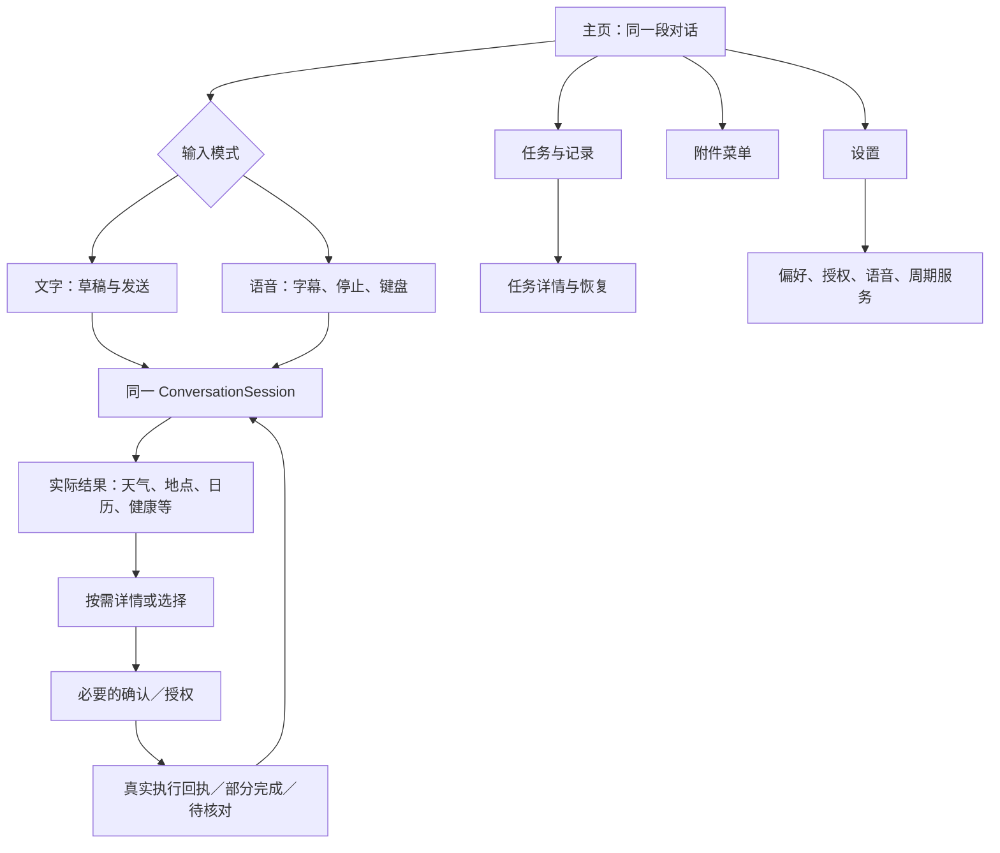

# 代号鲸鱼01：iOS 原生全系统 UI 与动效设计

日期：2026-11-10｜版本：重建提案 v2.0｜设备基准：iPhone16 Pro，402×874pt｜状态：完整设计交付，待产品评审与原生实现

## 1. 这次重建的目标

对话即主页。人先提出需求，界面再出现当前需要的数据、选择和动作。首页保留任务、设置、附件和唯一语音入口，没有常驻三标签导航、大角色主卡、功能宫格或内部工具日志。

把负责人所说的乔布斯式设计理解落实为：减少不必要选择，操作意义稳定，内容优先，复杂能力渐进展开。它是本项目的设计取向，不声称某个历史人物会认可本稿，也不把发布会视觉或旧版iOS外观当作今天的原生规范。

当前苹果HIG和真实系统组件是落地依据。新的视觉以系统语义色、系统字体、标准列表／表单／导航和sheet为核心；默认跟随系统明暗。25的极简入口、23的输入／任务分离继续保留。26/27作为此前规范与候选参考，本文件为新一轮完整重建提案，不自动宣称既有原生版本已更新。

## 2. 信息架构

顶部任务入口覆盖进行中、待确认、已完成与待核对记录；设置覆盖偏好、授权、主题、语音和周期服务。天气、音乐、出行和阅读没有永久一级标签，通过自然请求、附件菜单或当前结果进入。已开始的音乐才显示迷你播放器。

次级页面使用标准返回；短时选择与编辑使用sheet。系统权限提示、系统照片／文件选择、短信／邮件编辑界面由系统提供，不把AI设计图中的系统弹窗描成自己的权限组件。

## 3. 全部页面与功能落点

| 编号 | 界面 | 必要内容／动作 | 完成或退出边界 |
|---|---|---|---|
| S01 | 主页空状态 | 鲸鱼标题，任务／设置，轻问候，统一输入区 | 空白不提交，不自动开麦 |
| S02 | 对话与查询结果 | 自然段回复；紧凑天气／数据结果；来源与时间 | 有实际数据才出现结果；缺部分说明部分完成 |
| S03 | 语音倾听 | 同一主页、最终听写／字幕、停止、键盘 | 模式改变不另建会话，不丢文字草稿 |
| S04 | 语音处理／播报 | 明确阶段、可停止、最新任务结果 | 停止声音不撤销写入；回文字显示最新结果 |
| S05 | 任务与记录 | 进行中／待处理／日期分组，实际状态 | 不以生成了一段回答代替完成 |
| S06 | 提醒创建／编辑 | 标题、日期、时刻、时区；取消／创建或保存 | 校验后一次提交；旧确认失效；不会另建冒充修改 |
| S07 | 日历与空档 | 实际日历事件、可见空档，安排／修改入口 | 不把没记录的时间承诺为真正空闲 |
| S08 | 结果待核对 | 已执行步骤、未知项、查看已有记录 | 不默认重做写操作 |
| S09 | 附近比较 | 地点／半径／距离口径，候选、价格类型和来源 | 未知价不填零、不筛成预算合格 |
| S10 | 地点详情与来源 | 对应分店、直线距离、地址、价格来源和时间、地图交接 | 交接不等于导航已开始／已抵达／已订位 |
| S11 | 曲库／播放器 | 来源、实际曲目、队列和控制；可收起为迷你播放器 | 空库、订阅或不可播有准确状态；离页不重建队列 |
| S12 | 内容摘要与行动项 | 实际取得正文／页码，摘要，选择行动项 | 用户选择后再安排；只有链接先获取正文 |
| S13 | 设置 | 回复风格、主题、记忆、授权、语音、周期服务 | 主设置不要求输入供应商长期秘密 |
| S14 | 记忆偏好 | 来源可查、相关偏好、修改／删除 | 偏好不是自动操作授权；变动事实重新查 |
| S15 | 按需授权 | 当前用途解释、系统提示、拒绝后的替代路径 | 请求完成不等于全部读取授权；定位授权不等于位置已取到 |
| S16 | 网络／服务异常 | 保留原输入，准确错误，适用的重试／文字降级 | 读查询可有限重试，未知写入进入S08 |
| S17 | 周期服务 | 频率、时区、来源、条件、输出、试跑、暂停／恢复 | 来源离线准确等待；不保证秒级推送或后台随时读手机 |
| S18 | 通讯草稿与联系人选择 | 实际收件人候选、重名选择、正文、打开系统编辑器 | 用户发送／取消；回调不是送达／已读证明 |
| S19 | 健康与运动摘要 | 指标、区间、来源、实际数据或缺失 | HealthKit与签名条件满足才启用；无数据不报0 |
| S20 | 语音与音频设置 | 播报、字幕、语速、当前输出设备、可用性 | 只有真实ASR/TTS可用才开启相应控制 |

以上20个核心界面用五组生图画板呈现。低频和系统拥有的状态通过同一组件变体处理，不各自创造全新页面。

## 4. 必须覆盖的补充状态

| 类别 | 变体 | 呈现规则 |
|---|---|---|
| 初始化 | 首次启动、能力未配置、旧协议 | 不一次申请全部权限；当前能力表决定入口可用性 |
| 输入 | 空白、草稿、多行、中文候选、外接键盘 | 文字与语音含义固定；草稿保留；主操作不被键盘挡住 |
| 模型与执行 | 接收、处理、等待工具、等待选择、达到上限 | 用真实阶段反馈，不能用固定时长宣告成功 |
| 权限 | 未请求、拒绝、受限、系统设置返回 | 按参数索权；地区搜索不强制定位；健康读状态可能未知 |
| 内容 | 只有URL、缺页、扫描件、不可读图片、过长／加密 | 说明实际取得范围；不能假装全文已读 |
| 地点 | 空结果、位置超时／精度差、同名分店、未知／过期价格 | 保留原约束，适当降级或必要选择 |
| 音乐 | 空库、无匹配、不可播、队列边界、导入取消、语音打断 | 系统库与其他App缓存分开；用户暂停不无条件恢复 |
| 写入 | 缺参数、预览编辑、取消、成功、失败、回传中断、未知 | 每条确认绑定有效操作；只回传，不盲目重写 |
| 通讯 | 重名／多号码、设备不支持、发送／取消／失败／存草稿 | 选择来自本地授权对象，结果绑定原任务 |
| 生命周期 | 后台、来电、蓝牙／耳机变更、恢复、进程退出 | 音频、会话和任务独立恢复；旧回调不重启旧任务 |

天气、健康、分享扩展、通知等条件在成品能力表里明确标注。功能未接通时，不用截图里的演示数据伪装可用。

## 5. 视觉与组件规范

### 5.1 采用系统语义

- 使用systemBackground、secondarySystemGroupedBackground、label、secondaryLabel、separator等语义色；原型十六进制只是视觉近似，不覆盖系统增强对比。
- 默认跟随系统明暗。蓝色作为交互色，成功／警告／失败有图标、文字和对应语义色。
- 正文使用.body约17pt；次级说明.subheadline约15pt；标题按.headline／.title2／.largeTitle角色选取。首页标题保持克制，不能把所有页面都做成34pt大口号。
- 中文由系统字体回退处理。原生用Font／UIFont的语义样式和Dynamic Type，不把字号写成固定缩放截图。
- 图片用于内容和视觉参考，不代替按钮、文字、日期、输入和实时状态。

### 5.2 布局

- 首页横向参考20pt；8pt基础间距；结构化结果内16pt。
- 主要触控至少44×44pt。长标签增加高度，不缩字。来源、时刻、价格类型保持可读。
- 真实安全区由系统读取，背景可延伸，重要操作避让。不要绘制App自己的灵动岛、状态栏或Home Indicator。
- 主内容滚动，统一输入区用safeAreaInset／keyboardLayoutGuide定位。键盘出现时优先内容与输入，不保留无关一级导航。
- 确认表单采用原生toolbar中的取消／创建或保存；只保留一个积极提交动作。较大字和键盘下字段区可滚动，toolbar可达。
- 列表用标准InsetGrouped／Plain模式，sheet用系统detent；减少自己仿造系统材质与导航转场。

### 5.3 材质与系统版本

浮动输入或toolbar可以使用适当系统材质，但正文和关键字段必须有可靠对比。iOS26的新材质按availability评估；iOS17基线采用标准Material／实色降级，不强制复刻后续系统效果。

减少透明度、增强对比或低性能设备下优先实色。不存在“越透明越iOS”的规则。

## 6. 组件及原生映射

| 组件 | 结构 | 原生落点 |
|---|---|---|
| HomeToolbar | 标题＋任务＋设置 | toolbar／NavigationStack；SF Symbols |
| ConversationCanvas | 消息、短进度、结果、选择 | ScrollView／LazyVStack；阅读位置保护 |
| UnifiedComposer | 附件、草稿、语音、条件发送 | safeAreaInset，文本输入；多行自增高 |
| VoiceInputState | 字幕、阶段、停止、键盘 | 同一主页的输入状态；AVAudioSession／ASR/TTS回调 |
| TaskRecordList | 分组、状态、可继续事项 | List，真实持久化TaskRecord |
| CommitForm | 当前有效参数、取消、创建／保存 | Form＋sheet＋toolbar；参数和确认绑定 |
| ChoiceList | 当前有效候选、必要歧义选择 | List／confirmationDialog；候选引用校验 |
| ResultCard | 真实数据、来源、时刻、类型 | 通用容器＋领域内容；不放整块假回复 |
| PlaceDetail | 分店、地址、来源、交接 | MapKit＋List／sheet；地图返回交接状态 |
| MediaController | 队列、控制、状态、迷你版本 | 复用播放器协调器，不随View初始化重建 |
| SharedContentView | 实际内容范围、摘要、选中行动项 | Share／PhotosPicker／PDFKit＋主App处理 |
| PermissionGate | 用途、系统请求、拒绝降级 | PermissionCenter＋真正系统权限API |
| SystemHandoff | 短信／邮件／地图外部界面 | MessageUI／MapKit；系统回调关联任务 |
| PreferenceList | 相关事实、编辑／删除 | 可编辑结构化存储；明示删除范围 |
| RoutineForm | 时间／时区／来源／条件／输出 | 后端流程存储与运行记录；通知条件单独验证 |

任务成功来自执行器，语音状态来自实际音频链路，页面导航只改变路由。一个主Agent继续使用，不按页面新建Agent或Skill。

## 7. 动效系统

采用“先有状态意义，再决定是否动”的规则。原生已有的系统动画优先使用。下表是自定义微动效的起点，最终按真机测量调整，不是系统动画的硬替代。

| 事件 | 设计表现 | 参考时间／曲线 | 不允许的行为 |
|---|---|---|---|
| 发送输入 | 气泡进入，保留阅读位置 | 160–200ms，短easeOut | 强抢正在读的历史、重复发送 |
| 开始处理 | 小ProgressView＋文字阶段 | 即时显示，系统进度动画 | 大角色持续表演模拟思考 |
| 工具结果出现 | 容器淡入／小位移约4pt | 180–220ms | 提前显示完成，故意拖慢结果 |
| 展开详情 | 结构连续，系统push或sheet | 系统默认 | 从上进入却横向退出等不一致 |
| 输入转语音 | 原输入区局部变化，字幕保留 | 180–240ms，低弹性 | 新会话、清空草稿、两个同时开麦入口 |
| 音频幅度 | 依据实际RMS／播放幅度 | 跟随真实数据；更新频率受限 | 随机波形冒充已听见声音 |
| 打断 | 立即停止音频／旧字幕阶段 | 音频优先，不等待动画 | 等动画完才停声、默认取消任务 |
| 保存成功 | 小check与一次成功反馈 | 150–200ms，短symbolEffect可选 | 循环闪烁、每字震动 |
| 错误／未知 | 文本与图标替换，保留内容 | 120–180ms淡入 | 震屏、红色吓人、未知当失败重做 |
| 迷你播放器 | 同一内容收拢／展开 | 220–280ms或系统sheet | 重新加载队列／重复音频会话 |
| 键盘避让 | 输入跟随真实键盘 | 使用系统键盘动画 | 固定键盘高度、独立延迟动画 |

优先使用系统sheet、.snappy／.smooth等适用的原生过渡。Reduce Motion时改为短淡入或直接更新；不抹掉完成、失败和等待文字。Reduce Transparency时加厚背景或采用实色。触感有用户控制；主要选择.selection，真实成功.success，避免高频反复震动。

## 8. 状态与恢复

ConversationSession保存同一会话、草稿、候选与内容引用。InputMode区分文字／倾听／最终文本／处理／播报／暂停。TaskRecord区分补参数／确认／执行／已完成／部分完成／未知／取消。

切输入、切页、收起播放器不创建或重放任务。恢复只补回事件和回执；未知写入核对已有记录。退出语音恢复路由和草稿，最新TaskRecord不能被旧UI快照覆盖。

状态驱动动画，动画不决定状态。对话页出现、滚动或sheet展示都不能被当作用户确认。

## 9. 与历史要求的差异

此次采用更接近系统默认的语义色和明暗策略，26的深色薄荷基线保留为历史参考，不与本次v2候选混用。

08中的自定义左滑返回／右滑前进与iOS常见边缘返回存在冲突。本次设计推荐原生返回行为及可见历史控件；这是需在评审中明确的设计差异，不授权执行者静默反转原负责人指定方向。原型先提供返回按钮；原生最终手势在选定规范后单独实现和验收。

## 10. 交付与实施顺序

- 五组丹青约画板覆盖S01–S20，作为真实模型生成的视觉参考。
- 可点击HTML覆盖所有核心模块、状态和关键交互，另有动效演示与组件规范；它是原型而非原生验收。
- Token、screen-manifest、motion-spec、验收矩阵和生图来源记录均可交给执行者。
- 原生先实现主页／统一输入／任务／确认／设置，再复用结果组件覆盖地点、音乐、内容与扩展功能。

每步提交实际截图、iOS／设备／Build、正常和失败状态证据。没有真实系统执行时保持模拟口径。

## 11. 验收门槛

1. 首页无常驻底部三标签、功能宫格、大角色卡或重复语音按钮。
2. 输入空白不发送；语音与发送意义稳定；转语音保留草稿，返回恢复同一会话与最新结果。
3. 任务、设置从主页直接可达；深层有标准退出；不靠隐藏手势完成必要操作。
4. 表单只有一个积极提交动作，参数／时区准确，编辑使旧确认失效，取消不写入。
5. 真实来源、价格口径、内容范围、系统交接边界清晰；失败、未知和部分完成不伪装成功。
6. 窄屏、大字、中文键盘、VoiceOver、减少动态／透明度、增强对比均可用；触控主动作至少44pt。
7. 语音打断立即生效，任务不中断或重做；音乐与录音／TTS统一协调，来电／路由恢复正确。
8. 原生取实际safeArea与keyboardLayout，不能复制设计图的系统栏；新材质有系统版本降级。
9. 确认和发送来自真实用户事件，网页正文／模型文本不构成操作授权。
10. 性能报告包括设备、网络、样本量和分段耗时，不用视觉动画掩盖服务延迟。

## 12. 苹果官方依据

- [Human Interface Guidelines](https://developer.apple.com/design/human-interface-guidelines)
- [Motion](https://developer.apple.com/design/human-interface-guidelines/motion)：目的明确、短而精确、可取消、重要信息不只靠动效。
- [Typography](https://developer.apple.com/design/human-interface-guidelines/typography)
- [Accessibility](https://developer.apple.com/design/human-interface-guidelines/accessibility)
- [Sheets](https://developer.apple.com/design/human-interface-guidelines/sheets)
- [Materials](https://developer.apple.com/design/human-interface-guidelines/materials)

这些是设计参考，不代表苹果对本项目的认可。
